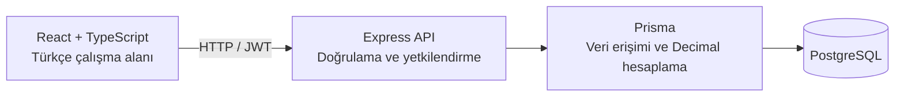

<div align="center">


# stockly.

### Her ürünün bir yeri, her stoğun bir hikâyesi var.

Ürünlerinizi keşfedin. Kritik stokları fark edin. Envanterinizi tek yerden yönetin.

**Türkçe arayüz · Koyu tema · Mobil uyum · Kullanıcıya özel sepet**


[Özellikler](#ozellikler) · [Hızlı başlangıç](#baslangic) · [Teknik yapı](#teknik-yapi) · [Testler](#testler) · [Dokümantasyon](#dokumantasyon)

</div>

---

Stockly, ürün kataloğu ve stok takibini sade bir çalışma alanında birleştirir. Genel bakıştan envanterinizin durumunu okuyabilir, ürünleri ad veya barkodla bulabilir ve kullanıcıya özel sepetlerle miktarları yönetebilirsiniz. React arayüzü, Express API üzerinden PostgreSQL'e bağlanır; fiyat ve toplamlar sunucuda Decimal hassasiyetiyle hesaplanır.

<a id="ozellikler"></a>

## ✨ Çalışma alanınızda neler var?

| | Özellik | Size ne sunar? |
| :---: | --- | --- |
| 📊 | **Bir bakışta envanter** | Ürün sayısı, toplam stok, envanter değeri ve kritik ürünler aynı panelde. |
| 📦 | **Düzenli ürün kataloğu** | Ad, ürün numarası veya barkodla arama; stok filtreleri, sıralama ve sayfalama. |
| 🚦 | **Stok takibi** | Tükenen ve düşük stoklu ürünleri görün; yönetici hesabıyla miktarları güncelleyin. |
| 🛒 | **Size özel sepet** | Ürün ekleyin, miktarı değiştirin; güncel fiyatları ve toplamları sunucudan alın. |
| 📤 | **Dışa aktarma** | Envanter ve sepet raporlarını Excel uyumlu UTF-8 CSV olarak indirin. |
| 🔐 | **Rol bazlı erişim** | Standart kullanıcı ve yönetici ayrımı; sunucuda doğrulanan ürün işlemleri. |
| 🔄 | **Güncel veriler** | Görünür sekmede 30 saniyede bir, sekmeye dönüşte veya elle yenileme. |
| 📱 | **Esnek kullanım** | Mobil menü, tablo/kart görünümü, klavye odağı ve `Ctrl K` arama kısayolu. |

> **Stok göstergeleri:** 🟢 10 adedin üzeri sağlıklı · 🟠 1–10 adet düşük stok · 🔴 0 adet tükenmiş

<a id="baslangic"></a>

## 🚀 Hızlı başlangıç

**Gereksinimler:** Node.js **22.12+**, npm ve erişilebilir bir **PostgreSQL** veritabanı. Node sürümü `.nvmrc` içinde tanımlıdır; frontend ve backend ayrı bağımlılık dosyaları kullanır.

### 1. Backend'i hazırlayın

Proje kökünden bir terminal açın:

```powershell
cd Backend
npm ci
```

`Backend/.env.example` dosyasını `Backend/.env` olarak kopyalayın. Mevcut `.env` dosyanız varsa koruyun. `DATABASE_URL` değerini kendi veritabanınızla, iki JWT secret değerini de birbirinden farklı rastgele değerlerle değiştirin.

```powershell
npx prisma generate
npx prisma migrate deploy
npm run dev
```

`migrate deploy`, ayarladığınız veritabanına bekleyen migration dosyalarını uygular. Backend varsayılan olarak **3000** portunu kullanır.

### 2. Frontend'i başlatın

Proje kökünden **ayrı bir terminal** açın:

```powershell
cd Frontend
npm ci
npm run dev
```

Tarayıcıda Vite'ın gösterdiği adresi açın; varsayılan adres **http://localhost:5173** olur. Geliştirme proxy'si API isteklerini varsayılan olarak **http://localhost:3000** adresine iletir.

<details>
<summary><strong>Backend farklı bir portta mı çalışıyor?</strong></summary>

`Frontend/.env.example` dosyasını `Frontend/.env.local` olarak kopyalayın; mevcut yerel dosyanız varsa onu düzenleyin. Hedefi backend'in `PORT` değerine göre ayarlayın:

```dotenv
API_PROXY_TARGET=http://localhost:8000
```

Değişiklikten sonra Vite'ı yeniden başlatın. Üretim API adresi ve reverse proxy seçenekleri [frontend rehberinde](Frontend/README.md#api-bağlantısı) açıklanır.

</details>

### 3. Çalışma alanınıza bağlanın

**Hesabıma giriş yap** üzerinden hesap oluşturun veya mevcut hesabınızla giriş yapın. Yeni hesaplar **standart kullanıcı** yetkisiyle açılır. Ürün ekleme, fiyat/stok güncelleme ve silme işlemleri **yönetici** yetkisi gerektirir. Ürün kataloğu ortaktır; sepetler kullanıcıya özeldir.

<a id="teknik-yapi"></a>

## 🧩 Teknik yapı



```text
product-manager/
├── Frontend/               React + Vite arayüzü
│   ├── src/components/     Paneller, katalog, sepet ve formlar
│   ├── src/hooks/          Oturum, veri ve işlem yönetimi
│   └── tests/              Playwright kullanıcı akışları
├── Backend/                Express + TypeScript API
│   ├── src/                Rotalar, middleware ve servisler
│   ├── prisma/             Şema ve veritabanı migration dosyaları
│   └── tests/              API ve servis testleri
├── .github/workflows/      Otomatik CI kontrolleri
└── ARCHITECTURE.md          Mimari ve API sözleşmeleri
```

**Veri doğruluğu:** Ürünler ve envanter özeti aynı okumadan üretilir. Sepet tutarları güncel ürün fiyatlarından hesaplanır. API yanıtları önbelleğe alınmaz; eski istek yanıtlarının yeni oturum verilerini ezmesi engellenir.

<a id="testler"></a>

## 🧪 Kalite kontrolleri

| Backend | Frontend |
| --- | --- |
| Kimlik doğrulama ve rol kontrolleri | Giriş, oturum ve rol bazlı arayüz |
| Ürün girdileri ve HTTP hata yanıtları | Ürün işlemleri, arama ve filtreler |
| Sepet sahipliği ve stok sınırları | Sepet miktarları ve toplamlar |
| Decimal hesaplama ve envanter özeti | Veri yenileme ve geciken yanıtlar |
| CORS ve veritabanı dayanıklılığı | Mobil görünüm ve pencere odağı |

Proje kökünden:

```powershell
# Backend: tip kontrolü ve testler
cd Backend
npm run typecheck
npm test

# Frontend: lint, üretim derlemesi ve tarayıcı testleri
cd ../Frontend
npm run lint
npm run build
npx playwright install chromium
npm run test:e2e
```

Testler canlı veritabanına yazmaz; API/Prisma işlemleri taklit edilir. Gerçek Prisma connector testi yerel bir TCP dinleyicisiyle timeout davranışını doğrular. Kurulu Chrome kullanımı [frontend rehberinde](Frontend/README.md#kontroller) anlatılır.

[GitHub Actions](.github/workflows/ci.yml), her push ve pull request'te backend kontrollerini ve frontend lint, derleme ve Chromium testlerini çalıştırır. CI için canlı veritabanı veya GitHub secret kurulumu gerekmez.

<a id="dokumantasyon"></a>

## 📚 Biraz daha yakından

| Rehber | İçerik |
| --- | --- |
| [Frontend](Frontend/README.md) | Arayüz özellikleri, API bağlantısı, ortam ayarları ve tarayıcı testleri |
| [Backend](Backend/README.md) | Kurulum, token akışı, ürün/sepet API'si ve veritabanı bağlantı yönetimi |
| [Mimari](ARCHITECTURE.md) | Veri modeli, katmanlar, API sözleşmeleri ve mevcut sınırlar |

<details>
<summary><strong>📤 Projeyi kendi GitHub deponuza yükleme</strong></summary>

GitHub'da README, lisans veya `.gitignore` eklemeden boş bir depo oluşturun. Git henüz başlatılmamışsa proje kökünde `git init -b main` çalıştırın. Ardından adresi kendi depo adresinizle değiştirin:

```powershell
git add .
git diff --cached --stat
git commit -m "Initial commit"
git remote add origin https://github.com/USERNAME/REPOSITORY.git
git push -u origin main
```

Commit için Git kullanıcı adı ve e-posta ayarlarınız tanımlı olmalıdır. `.gitignore`; gerçek ortam dosyalarını, bağımlılıkları, derleme çıktılarını ve yerel test raporlarını dışarıda tutar. Örnek ortam dosyaları ve migration dosyaları depoya dahildir.

</details>

## 🛤️ Mevcut kapsam

Stockly ürün, envanter ve sepet yönetimine odaklanır. Sepete ekleme stok ayırmaz veya azaltmaz. Satış/ödeme tamamlama, satış geçmişi, ürün görseli yükleme ve otomatik token yenileme henüz bulunmaz.

---

<div align="center">

**stockly.** · Daha düzenli bir katalog. Daha görünür stoklar.

</div>
